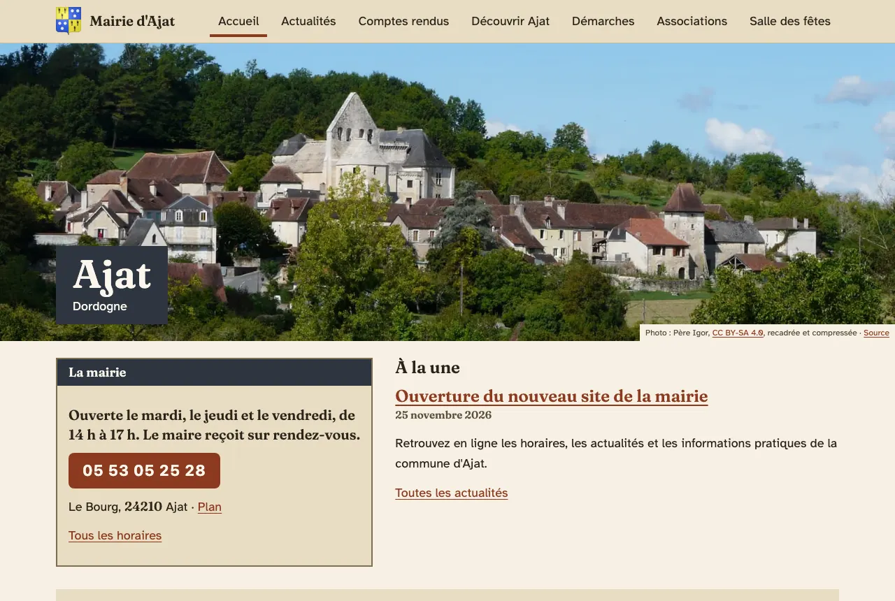
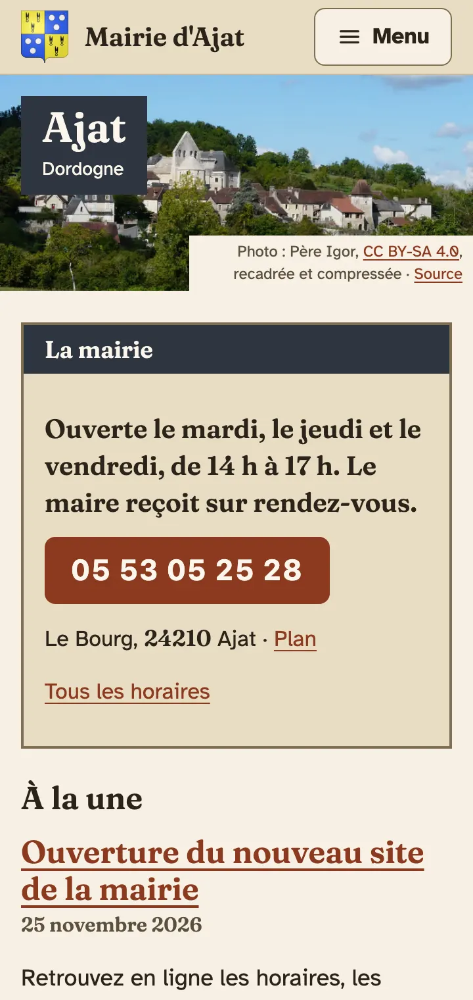
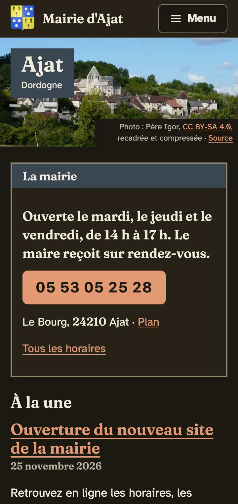
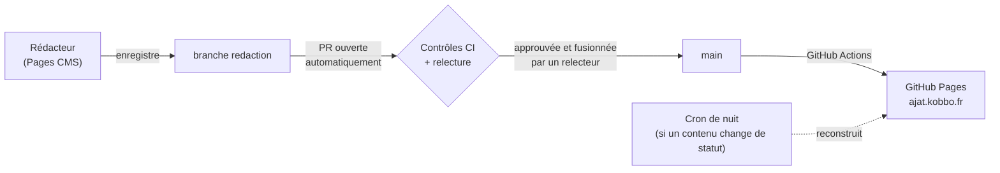

<div align="center">

# Mairie d'Ajat — site web

**Le site public de la commune d'Ajat (Dordogne) : statique, accessible, sobre, et modifiable par les élus sans toucher au code.**

[](https://github.com/k1n0b0n/ajat-mairie/actions/workflows/deploy.yml)
[](https://ajat.kobbo.fr)
[](https://astro.build)
[](docs/declaration-ecoconception.md)
[](docs/declaration-ecoconception.md)
[](#qualité-et-contrôles)
[](#licences-et-crédits)
[](.specify/memory/constitution.md)

</div>

<table>
  <tr>
    <td width="68%"></td>
    <td width="16%"></td>
    <td width="16%"></td>
  </tr>
</table>

> **Domaine provisoire.** Le site est publié sur `ajat.kobbo.fr` en attendant le domaine définitif. Il est volontairement **non indexable** par les moteurs de recherche (voir [Déploiement](#déploiement)). Les horaires, l'adresse et le courriel sont à confirmer par la mairie : voir [`docs/contenus-a-fournir.md`](docs/contenus-a-fournir.md).

## Sommaire

- [Pourquoi ce projet](#pourquoi-ce-projet)
- [Les dix principes](#les-dix-principes)
- [Fonctionnalités](#fonctionnalités)
- [Pile technique](#pile-technique)
- [Démarrage rapide](#démarrage-rapide)
- [Structure du dépôt](#structure-du-dépôt)
- [Contenu et édition](#contenu-et-édition)
- [Qualité et contrôles](#qualité-et-contrôles)
- [Déploiement](#déploiement)
- [Conception pilotée par les spécifications](#conception-pilotée-par-les-spécifications)
- [Documentation](#documentation)
- [Contribuer](#contribuer)
- [Sécurité](#sécurité)
- [Licences et crédits](#licences-et-crédits)

## Pourquoi ce projet

Une commune rurale n'a ni équipe technique ni budget d'exploitation. Ce site est donc conçu pour **ne rien coûter à faire vivre** : pas de serveur, pas de base de données, pas de cookie, pas de script tiers. Les élus publient depuis un formulaire, une autre personne relit, et le site se met à jour tout seul.

Il s'adresse d'abord aux habitants, souvent âgés et parfois en zone de faible débit : trouver quand la mairie est ouverte, lire les actualités, consulter les comptes rendus du conseil municipal, connaître les démarches, les associations et les conditions de location de la salle des fêtes. Il s'adresse ensuite aux visiteurs qui découvrent le village et son patrimoine.

## Les dix principes

Ils sont inscrits dans la [constitution du projet](.specify/memory/constitution.md) (version 1.2.0) et vérifiés par la chaîne de contrôle : aucune fonctionnalité ne peut y déroger.

| # | Principe | En pratique |
|---|---|---|
| I | **Accessibilité** | RGAA et WCAG 2.1 niveau AA : contrastes calculés par script, navigation au clavier, `axe` sans violation, espacements de texte modifiables |
| II | **Mobile first** | Conçu pour 320 px d'abord ; l'essentiel est visible sans défiler sur un téléphone |
| III | **Performance** | Lighthouse supérieur à 90 sur les quatre catégories, en mobile |
| IV | **Aucun traceur** | Aucun cookie, aucune requête tierce, polices auto-hébergées : donc aucun bandeau de consentement |
| V | **RGPD et mentions légales** | Aucune donnée collectée ; mentions légales, confidentialité et déclaration d'accessibilité publiées |
| VI | **Site statique, maintenance quasi nulle** | HTML généré au build, aucun runtime en production |
| VII | **Édition sans compétence technique** | Formulaires, brouillon, relecture par une personne distincte, retour arrière en un clic |
| VIII | **Contenu ouvert** | Markdown et YAML dans Git ; aucun format ni outil propriétaire |
| IX | **Sobriété numérique** | Accueil ≤ 120 Ko sur téléphone, page de texte ≤ 100 Ko, 10 requêtes au plus, 3 polices au plus |
| X | **Identité propre, pas de gabarit** | Une page qui ne pourrait être que celle d'Ajat ; audit `unslop` avant toute refonte visuelle |

## Fonctionnalités

- **Accueil** : la photo du bourg avec la plaque « Ajat », l'affiche « La mairie » (horaires en **une phrase calculée** à partir des horaires saisis, téléphone, adresse), la dernière actualité, le texte « Le village ».
- **La mairie** : le tableau d'ouverture jour par jour, les fermetures exceptionnelles, les coordonnées et l'accès.
- **Actualités** et **comptes rendus du conseil municipal** (PDF avec poids et date de séance).
- **Démarches** courantes avec lien vers la fiche officielle, **associations** et leurs contacts, **salle des fêtes** (conditions et tarifs), **liens utiles**.
- **Découvrir Ajat** : le village, son patrimoine et ses environs, avec photos créditées.
- **Pages légales** : mentions légales et crédits, politique de confidentialité, déclaration d'accessibilité, plan du site.
- **Thème sombre automatique**, contraste élevé du système pris en charge, menu téléphone sans JavaScript.
- **Publication programmée** : une actualité datée dans le futur apparaît toute seule le jour venu.

## Pile technique

| Rôle | Choix |
|---|---|
| Générateur | [Astro 7](https://astro.build) en mode `static`, TypeScript strict, CSS natif (aucun framework) |
| Contenu | Content collections : Markdown et YAML dans `src/content/` |
| Édition | [Pages CMS](https://pagescms.org) (open source) configuré par [`.pages.yml`](.pages.yml) |
| Polices | [Fraunces](https://fonts.google.com/specimen/Fraunces) et [Atkinson Hyperlegible](https://brailleinstitute.org/freefont) via Fontsource, **auto-hébergées** |
| Hébergement | GitHub Pages, domaine personnalisé, HTTPS imposé |
| Intégration continue | GitHub Actions |
| Tests | [Playwright](https://playwright.dev), [axe-core](https://github.com/dequelabs/axe-core), [Lighthouse CI](https://github.com/GoogleChrome/lighthouse-ci), [lychee](https://lychee.cli.rs) |
| Gouvernance | [Spec Kit](https://github.com/github/spec-kit) : constitution, spécifications, plans et tâches dans [`specs/`](specs) |

Aucun JavaScript n'est envoyé au visiteur.

## Démarrage rapide

**Prérequis** : Node.js ≥ 22.23.4 (la version de `.nvmrc` est utilisée en CI).

```bash
git clone git@github.com:k1n0b0n/ajat-mairie.git
cd ajat-mairie
npm ci
npx playwright install chromium   # une fois, pour les tests

npm run dev        # serveur de développement sur http://localhost:4321
npm run build      # génère le site dans dist/
npm run preview    # sert dist/ en local
npm run check      # build + tous les contrôles + tests (à lancer avant chaque PR)
npm run lhci       # Lighthouse mobile sur une page par rubrique
```

> **Sous un agent ou un terminal sans TTY**, `astro dev` et `astro preview` passent en arrière-plan ; ajoutez `--ignore-lock` pour les garder au premier plan (déjà fait dans la configuration des tests).

Pour aller plus loin : [`docs/developpement.md`](docs/developpement.md).

## Structure du dépôt

```text
.
├── src/
│   ├── content/            # le contenu : actualités, comptes rendus, démarches, associations, pages, données YAML
│   ├── components/         # composants Astro (aucun JavaScript client)
│   ├── layouts/            # Base.astro : en-tête, pied de page, CSP, polices
│   ├── pages/              # routes : accueil, La mairie, listes, plan du site, 404
│   ├── lib/                # logique pure : phrase d'horaires, dates, images, navigation
│   ├── styles/             # tokens.css (palette, polices, espacements), fonts.css, global.css
│   ├── assets/             # blason, signature, photos sources (optimisées au build)
│   └── content.config.ts   # schémas des collections (validés au build)
├── public/                 # CNAME, PDF des comptes rendus, images du texte
├── scripts/                # contrôles : contrastes, identité, images, contenu, mesure, Lighthouse
├── tests/                  # Playwright : accessibilité, thèmes, budgets, liens, chiffres…
├── docs/                   # guides : administration, rédacteur, relecteur, écoconception
├── specs/                  # spécifications 001 à 003 : spec, plan, recherche, contrats, tâches
├── .github/                # workflows, CODEOWNERS, modèles de PR et de tickets
├── .specify/               # constitution et outillage Spec Kit
└── .pages.yml              # interface d'édition (Pages CMS)
```

## Contenu et édition

Tout le contenu vit dans `src/content/` et se modifie **sans toucher au code**, depuis Pages CMS :

| Contenu | Dossier ou fichier | Format |
|---|---|---|
| Actualités | `src/content/actualites/` | Markdown |
| Comptes rendus | `src/content/comptes-rendus/` + PDF dans `public/documents/` | Markdown |
| Démarches | `src/content/demarches/` | Markdown |
| Associations | `src/content/associations/` | Markdown (accord de publication obligatoire) |
| Découvrir, pages légales | `src/content/pages/` | Markdown |
| Horaires, coordonnées | `src/content/donnees/mairie.yml` | YAML : **source unique** de l'accueil et de « La mairie » |
| Salle des fêtes, liens, texte d'accueil, photo d'accueil | `src/content/donnees/*.yml` | YAML |

Chaque collection a un **schéma validé au build** : un champ manquant, une adresse qui ne commence pas par `https://` ou une image sans description fait échouer la construction avec un message en français.



Le rédacteur n'a **jamais** de droit d'écriture sur `main` : un **relecteur distinct** approuve et fusionne. Un brouillon (`draft: true`) n'est jamais publié ; une publication erronée s'annule avec « Revert ». Guides pas à pas : [rédacteur](docs/aide-redacteur.md) et [relecteur](docs/aide-relecteur.md).

## Qualité et contrôles

`npm run check` enchaîne le build, cinq scripts et la suite Playwright. Rien ne se publie si un contrôle échoue.

| Contrôle | Ce qu'il garantit |
|---|---|
| `scripts/check-contrast.mjs` | Contraste WCAG AA de tous les couples de couleurs, en clair et en sombre ; aucune couleur en dur hors `tokens.css` |
| `scripts/check-identite.mjs` | Principe X : aucun dégradé CSS, aucun mot interdit (« moderne », « épuré », « premium ») |
| `scripts/check-images.mjs` | Toute image servie ≤ 200 Ko ; blason et signature SVG sans contenu actif |
| `scripts/check-content.mjs` | Images Markdown décrites, PDF présents et légers, pages légales publiées, adresses uniques |
| `tests/a11y`, `themes`, `text-spacing`, `mobile-320` | `axe` sans violation (clair, sombre, contraste élevé), espacements RGAA 10.12, pas de défilement horizontal à 320 px |
| `tests/no-tracking`, `indexation` | Aucun cookie ni requête tierce ; `noindex` tant que l'indexation n'est pas activée |
| `tests/page-budget` | Budgets de poids, de requêtes et de polices de la constitution (principe IX) |
| `tests/home-*`, `identite`, `chiffres`, `la-mairie`, `horaires-phrase` | Accueil à 360 × 640, liens uniques, plaque lisible, chiffres sans zéro barré, phrase d'horaires |
| `lychee` + `npm run lhci` | Liens internes et Lighthouse mobile supérieur à 90, exécutés en CI |

Mesure à la demande : `node scripts/mesure-pages.mjs` affiche le poids et le nombre de requêtes de chaque page type. Mesures de référence : [`docs/declaration-ecoconception.md`](docs/declaration-ecoconception.md).

## Déploiement

| Workflow | Déclencheur | Rôle |
|---|---|---|
| [`ci.yml`](.github/workflows/ci.yml) | PR vers `main`, push sur `redaction` | Build, contrôles, tests, liens internes, Lighthouse |
| [`deploy.yml`](.github/workflows/deploy.yml) | Push sur `main` (hors documentation) | Construit et publie sur GitHub Pages |
| [`nightly.yml`](.github/workflows/nightly.yml) | Chaque nuit, et le lundi pour les liens externes | Reconstruit **seulement si un contenu change de statut** (publication programmée, fermeture qui expire) |
| [`pr-redaction.yml`](.github/workflows/pr-redaction.yml) | Push sur `redaction` | Ouvre la PR de relecture |
| [`preview.yml`](.github/workflows/preview.yml) | Push sur `redaction` | Aperçu des brouillons (désactivé tant que la variable `APERCU_ACTIF` n'existe pas) |

- **Indexation** : désactivée par défaut. Pour l'autoriser au passage au domaine définitif : `gh variable set INDEXATION --body on`, puis redéployer.
- **`main` est protégée** : pas de push direct, une pull request, le contrôle `controles` obligatoire. Détails et réglages : [`docs/administration.md`](docs/administration.md).

## Conception pilotée par les spécifications

Le site est construit avec [Spec Kit](https://github.com/github/spec-kit) : chaque évolution passe par une spécification, un plan, des contrats et une liste de tâches, tous versionnés dans [`specs/`](specs).

| Spécification | Sujet |
|---|---|
| [`001-site-mairie-ajat`](specs/001-site-mairie-ajat) | Le site, son édition par les élus, sa chaîne de publication |
| [`002-identite-visuelle`](specs/002-identite-visuelle) | Palette, polices auto-hébergées, accueil, menu téléphone, sobriété numérique |
| [`003-personnalite-du-site`](specs/003-personnalite-du-site) | La personnalité d'Ajat : affiche « La mairie », phrase d'horaires, plaque, signature |

Chaque dossier contient `spec.md`, `plan.md`, `research.md`, `data-model.md`, `contracts/`, `quickstart.md`, `tasks.md` et, pour la 003, l'audit `unslop` et sa validation.

## Documentation

| Document | Pour qui |
|---|---|
| [`docs/README.md`](docs/README.md) | Index de la documentation |
| [`docs/architecture.md`](docs/architecture.md) | Comprendre comment le site est construit et publié |
| [`docs/developpement.md`](docs/developpement.md) | Développer, tester, ajouter une page, un composant, un jeton |
| [`docs/administration.md`](docs/administration.md) | Administrateur : dépôts, protection de `main`, Pages CMS, domaine, indexation |
| [`docs/aide-redacteur.md`](docs/aide-redacteur.md) | Élus qui rédigent |
| [`docs/aide-relecteur.md`](docs/aide-relecteur.md) | Relecteurs qui publient |
| [`docs/declaration-ecoconception.md`](docs/declaration-ecoconception.md) | Écoconception (RGESN) et mesures de référence |
| [`docs/contenus-a-fournir.md`](docs/contenus-a-fournir.md) | Ce que la mairie doit encore fournir ou confirmer |

## Contribuer

Les contributions sont les bienvenues, qu'il s'agisse de code, de contenu ou de signalements. Lisez [`CONTRIBUTING.md`](CONTRIBUTING.md) : branche, pull request, contrôles, convention de commits, et la règle d'audit visuel du principe X. Merci de respecter le [code de conduite](CODE_OF_CONDUCT.md).

## Sécurité

Le dépôt est public : il ne contient **aucun secret ni donnée personnelle non publiable**. Pour signaler une vulnérabilité, suivez [`SECURITY.md`](SECURITY.md).

## Licences et crédits

**Titulaire des droits : Commune d'Ajat et contributeurs.**

| Quoi | Licence |
|---|---|
| **Code** (composants, scripts, tests, styles, configuration) | [MIT](LICENSE) |
| **Textes et contenus de la commune** | [CC BY-SA 4.0](LICENSE-CONTENU.md) : citer la source, partager les adaptations dans les mêmes conditions |
| **Éléments tiers** (photos, blason, polices, textes adaptés de Wikipédia) | leur propre licence, ci-dessous |

Le détail, les exceptions et la mention sur le blason et le nom de la commune sont dans [`LICENSE-CONTENU.md`](LICENSE-CONTENU.md).

Éléments tiers, tous crédités dans la page « Mentions légales » du site (et tenant leur propre licence) :

| Élément | Auteur | Licence |
|---|---|---|
| Photo d'accueil « Ajat bourg » | Père Igor | [CC BY-SA 4.0](https://creativecommons.org/licenses/by-sa/4.0/deed.fr) |
| Photo « Château d'Ajat » | GuillaumeG | [CC BY-SA 3.0](https://creativecommons.org/licenses/by-sa/3.0/deed.fr) |
| Photo « Le bourg d'Ajat » | marcel ruessaf | [CC BY-SA 3.0](https://creativecommons.org/licenses/by-sa/3.0/deed.fr) |
| Photo « Limeyrat causse près Peyre Levade » | Père Igor | [CC BY-SA 3.0](https://creativecommons.org/licenses/by-sa/3.0/deed.fr) |
| Photo « Ajat mairie » | Père Igor | [CC BY-SA 4.0](https://creativecommons.org/licenses/by-sa/4.0/deed.fr) |
| Photo « Salle des fêtes d'Ajat » | marcel ruessaf | [CC BY-SA 3.0](https://creativecommons.org/licenses/by-sa/3.0/deed.fr) |
| Blason d'Ajat (statut officiel à confirmer) | Henry Salomé | CC BY-SA 3.0 ou GFDL 1.2+ |
| Textes de « Découvrir Ajat » (adaptés de Wikipédia) | Contributeurs de Wikipédia | [CC BY-SA 4.0](https://creativecommons.org/licenses/by-sa/4.0/deed.fr) |
| Polices Fraunces et Atkinson Hyperlegible | Undercase Type ; Braille Institute | [SIL OFL 1.1](https://openfontlicense.org/) |
