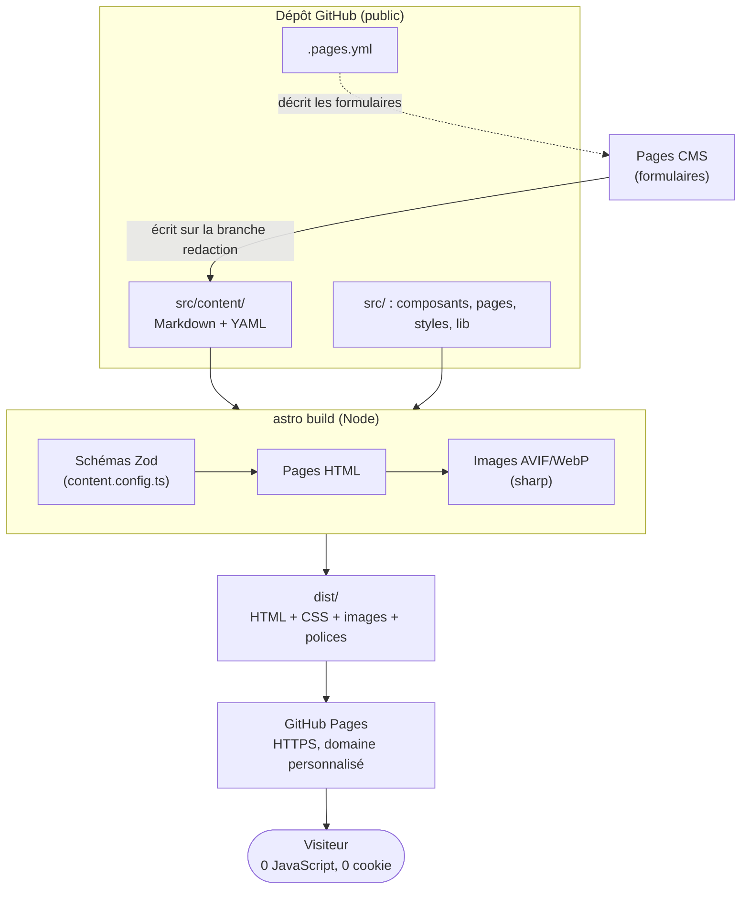
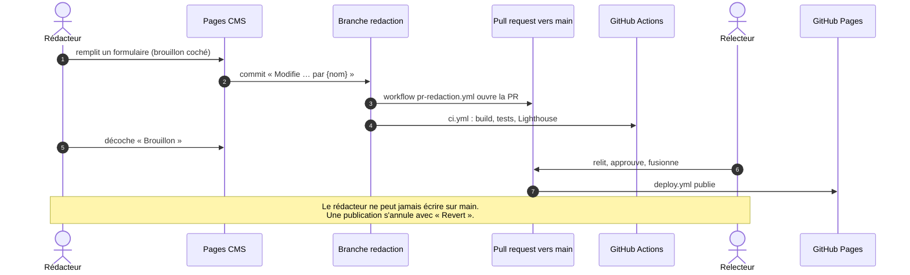

# Architecture

Le site est un **site statique** : tout est calculé au build, rien ne tourne en production. Ce document explique les pièces, leurs liens et les décisions qui les justifient.

## Vue d'ensemble

## Le contenu

- **Collections** déclarées dans [`src/content.config.ts`](../src/content.config.ts) : `actualites`, `comptes-rendus`, `demarches`, `associations`, `pages` (loader `glob`, Markdown) ; `mairie`, `salle-des-fetes`, `liens`, `visuels`, `accueil` (loader `file`, YAML).
- Chaque collection a un **schéma Zod** : types, longueurs, formats d'URL (https uniquement), image décrite, accord de publication des associations, horaires cohérents (une fermeture après l'ouverture, pas de chevauchement). Un contenu invalide **fait échouer le build** avec un message en français.
- **Champs communs** ([`src/lib/schema-commun.ts`](../src/lib/schema-commun.ts)) : `title`, `draft` (défaut `true`), `publishDate`, `updatedDate`.
- **Publication** : [`getPublies()`](../src/lib/published.ts) exclut les brouillons et les contenus datés dans le futur ; avec `PREVIEW=1` (aperçu), tout est visible.
- **Source unique des horaires** : `src/content/donnees/mairie.yml`. L'accueil affiche une phrase construite par [`phraseHoraires()`](../src/lib/horaires-phrase.ts) (jours regroupés par plages identiques, fermetures à venir) ; la page « La mairie » affiche le tableau.

## Le rendu

| Pièce | Rôle |
|---|---|
| [`layouts/Base.astro`](../src/layouts/Base.astro) | Gabarit : CSP par balise `<meta>` (aucun script, aucune ressource tierce), préchargement de deux polices, lien d'évitement, `noindex` selon l'indexation, zone pleine largeur pour la photo |
| [`components/`](../src/components) | Composants `.astro` **sans JavaScript client** : `Hero` (photo en direction artistique 2:1 mobile, 3:1 ordinateur, plaque du nom), `LaMairie` (affiche), `AlaUne`, `DansLaCommune`, `Nav` (menu `popover` natif), `Header`, `Footer`… |
| [`styles/tokens.css`](../src/styles/tokens.css) | **Jetons** : palette claire et sombre (pierre, tuile, ardoise), polices, échelle d'espacement sur 4 px, classes `.chiffres` et `.numero` |
| [`styles/global.css`](../src/styles/global.css) | Composants et mise en page, uniquement avec des jetons ; le bloc `forced-colors` (contraste élevé) est volontairement **en fin de fichier** pour l'emporter |
| [`lib/images.ts`](../src/lib/images.ts) | Retrouve une image de `src/assets/images/` par son nom de fichier (le chemin écrit par Pages CMS n'est pas fiable) |
| [`pages/`](../src/pages) | Routes ; `[...slug].astro` rend la collection `pages` (découverte, mentions légales, accessibilité…) |

**Menu téléphone** : un bouton `popovertarget` ouvre un `<nav popover>` (API Popover du navigateur). Échap et le clic extérieur le ferment sans JavaScript. Sur écran large, la même navigation s'affiche en ligne. Un navigateur sans Popover garde simplement la liste visible.

**Images** : les sources (≤ 600 Ko) sont dans `src/assets/images/` ; Astro génère des variantes AVIF et WebP à plusieurs largeurs ; chaque fichier servi doit rester ≤ 200 Ko. L'image de repli de `<picture>` est fixée à une largeur précise pour ne pas servir la source entière.

## L'édition

- La configuration de Pages CMS est lue **par branche** : `sync-redaction.yml` ramène automatiquement dans `redaction` chaque fusion dans `main` qui ne vient pas d'elle.
- Les commits portent le **nom** du rédacteur mais pas son courriel (`commit.identity: app`) : le dépôt est public.
- L'aperçu des brouillons (`preview.yml`, dépôt `-apercu` séparé) est prêt mais désactivé : il s'active avec la variable `APERCU_ACTIF`.

## La qualité

- **Contrôles statiques** (scripts Node) : contrastes, identité (principe X), images, contenu. Voir le tableau du [README](../README.md#qualité-et-contrôles).
- **Tests Playwright** : parcourent **toutes les pages du sitemap** (`tests/helpers/urls.ts`) : une page ajoutée est testée sans rien configurer (axe, 320 px, aucun traceur, budgets de poids).
- **Lighthouse CI** : une page par rubrique, profil mobile ; `scripts/lhci.mjs` écarte l'audit « explorable » tant que le site est volontairement non indexable.
- **Budgets** (constitution, principe IX) : mesurés comme sur l'hébergeur (texte compressé en gzip) par `scripts/lib/mesure.mjs`.

## Le déploiement

| Étape | Détail |
|---|---|
| Déclencheur | push sur `main` (les documents `docs/`, `specs/`, README… ne redéploient pas) |
| Construction | action officielle `withastro/action`, Node 26 |
| Publication | `actions/deploy-pages` vers GitHub Pages |
| Domaine | `public/CNAME` + réglage Pages ; certificat Let's Encrypt géré par GitHub ; HTTPS imposé |
| Reconstruction nocturne | `nightly.yml` appelle `deploy.yml` **seulement** si [`scripts/changement-du-jour.mjs`](../scripts/changement-du-jour.mjs) détecte un contenu qui change de statut (publication programmée, fermeture exceptionnelle qui expire) |

### Variables

| Variable | Où | Effet |
|---|---|---|
| `INDEXATION` | variable de dépôt | `on` : autorise les moteurs de recherche (balise `meta robots`, `robots.txt`, sitemap annoncé). Par défaut : **non indexable**. |
| `PREVIEW` | build de l'aperçu | `1` : inclut les brouillons et les contenus programmés, bandeau « APERÇU », `noindex` |
| `SITE_URL`, `SITE_BASE` | variables de dépôt, facultatives | Base de l'aperçu ; vides en production (le domaine est dans `astro.config.mjs`) |
| `APERCU_ACTIF` | variable de dépôt | `true` : active `preview.yml` |

## Sécurité et vie privée

- **CSP** posée par `<meta>` (GitHub Pages ne permet pas d'en-têtes personnalisés) : `default-src 'none'`, images, styles et polices de la même origine, aucun script.
- **Aucun cookie, aucune requête vers un autre domaine** : vérifié à chaque PR sur toutes les pages.
- **Redirections** : GitHub Pages n'a pas de redirections serveur ; toute adresse déplacée se déclare dans `redirects` d'`astro.config.mjs` (page de redirection générée).
- **Journaux** : l'hébergeur (GitHub) peut enregistrer l'adresse IP ; c'est dit dans la politique de confidentialité.

## Décisions et limites connues

- **Pages CMS** n'a ni brouillon, ni relecture, ni aperçu natifs : ils sont construits avec le champ `draft`, la branche `redaction`, la PR automatique et la protection de `main` ([`specs/001-site-mairie-ajat/research.md`](../specs/001-site-mairie-ajat/research.md) R3 à R6).
- **Cache** : GitHub Pages impose une durée de cache courte non configurable ([déclaration d'écoconception](declaration-ecoconception.md)).
- **Hébergement hors UE** : assumé et déclaré dans la politique de confidentialité.
- **Zéro barré** : les chiffres d'affichage sont en Fraunces et le numéro de téléphone en police du système ; un « 0 » dans une phrase de texte courant reste en Atkinson ([`specs/003-personnalite-du-site/research.md`](../specs/003-personnalite-du-site/research.md) R6).
